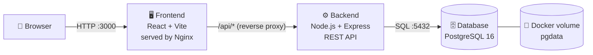
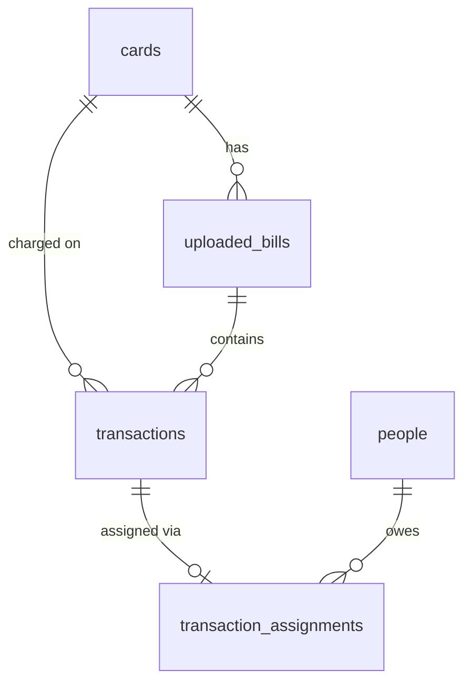

<div align="center">

# 💳 CardSplit

### Credit Card Bill Splitter — upload a statement, assign every expense, send a clean PDF


**[Quick Start](#-quick-start)** ·
**[Architecture](#-architecture)** ·
**[API Reference](#-api-reference)** ·
**[Full Setup Guide](setup_guide/setup.md)**

</div>

---

## 📖 Project Description

**CardSplit** is a web application that turns a messy credit card statement into a fair, itemised split between the people who actually spent the money.

You upload the PDF statement your bank sends you. CardSplit reads it **inside your browser**, pulls out every debit transaction, and lets you assign each one to a person — a flatmate, a family member, a friend, or yourself. When you are done, it generates a professional **A4 PDF statement per person** showing exactly what they owe and by when, ready to send for settlement.

This repository is the **microservice edition** of CardSplit. The original single-application project has been split into three independent, containerised services — **Frontend**, **Backend** and **Database** — each with its own `Dockerfile`, plus a `docker-compose.yml` that starts the whole stack with one command.

## 🎯 Use Case

Many households put shared spending on one card — rent-adjacent bills, groceries, food delivery, travel bookings, streaming subscriptions — and then spend hours with a bank statement and a calculator working out who owes what.

CardSplit is built for that exact problem:

| Situation | How CardSplit helps |
|---|---|
| 🏠 **Flatmates** paying shared bills with one card | Assign each line to the right flatmate and send everyone their own statement |
| 👨‍👩‍👧 **Family** where one card pays for several people | Keep each person's spending separate, month after month |
| ✈️ **Group trips** booked on one person's card | Split flights, stays and meals across the group |
| 💼 **Personal vs. shared** expenses | Mark which transactions are yours and which belong to someone else |
| 🗓️ **Multiple cards** with different due dates | Track every card, its statement date and due date in one place |

## ✨ Features

- 📄 **PDF statement parser** — extracts debit transactions from bank statements; works across different bank layouts, supports password-protected PDFs
- 🔒 **Privacy-friendly parsing** — the PDF is read in your browser; only the extracted transactions are sent to your own server (the file itself is never uploaded)
- 🧾 **Review before import** — check and select the extracted rows before they are saved; add transactions manually or paste statement text
- 👥 **People & cards management** — multiple credit cards (issuer, network, statement date, due date) and multiple people
- 🧮 **One-click assignment** — assign each transaction to a person, filter, search and sort the combined table
- 📊 **Dashboard** — an at-a-glance overview of cards, people, bills and spending
- 🖨️ **Per-person PDF statements** — itemised, A4, with card-wise summary and the "pay me by" date
- 🛡️ **Admin lock** — all changes (add / edit / delete / import) require a master password, now verified **on the server**
- 💾 **Backup & restore** — export everything to JSON and import it again
- 🐳 **One-command deployment** — three containers, persistent database volume, health checks

## 🏗 Architecture



| Service | Folder | Technology | Responsibility | Port |
|---|---|---|---|---|
| **Frontend** | [`frontend/`](frontend) | React 19, Vite, Tailwind CSS, pdf.js, jsPDF → Nginx | UI, PDF statement parsing, PDF generation. Nginx also forwards `/api/*` to the backend | **3000** → 80 |
| **Backend** | [`backend/`](backend) | Node.js 22, Express | REST API, validation, admin authorisation, all business rules | **5000** |
| **Database** | [`database/`](database) | PostgreSQL 16 | Persistent storage. Schema is created automatically on first start | 5432 *(private)* |

**Why this design?**

- Each service has **one job** and can be built, scaled, replaced or deployed on its own.
- The **database is never exposed** to the outside world — only the backend can reach it.
- The browser talks to **one address only** (`:3000`); Nginx routes `/api` internally, so there are no CORS headaches.
- Data lives in a **Docker volume**, so it survives container restarts and rebuilds.

## 📁 Project Structure

```text
CardSplit-Microservices/
├── docker-compose.yml          # Starts all three services together
├── .env.example                # Copy to .env and set your passwords / ports
├── README.md                   # You are here
├── setup_guide/
│   └── setup.md                # Detailed step-by-step setup guide (start here if new to Docker)
│
├── database/                   # ── Microservice 1: PostgreSQL ──
│   ├── Dockerfile
│   └── init/01-schema.sql      # Tables, constraints, indexes (auto-run on first start)
│
├── backend/                    # ── Microservice 2: REST API ──
│   ├── Dockerfile
│   ├── package.json
│   └── src/
│       ├── server.js           # App entry point, routing, error handling
│       ├── config.js           # Environment-based configuration
│       ├── db.js               # PostgreSQL connection pool, transactions, start-up retry
│       ├── utils.js            # Validation helpers
│       ├── middleware/auth.js  # Admin password check + brute-force limiter
│       └── routes/             # health, admin, cards, people, bills, transactions, backup
│
└── frontend/                   # ── Microservice 3: Web UI ──
    ├── Dockerfile              # Multi-stage: build with Node → serve with Nginx
    ├── nginx.conf.template     # Static files + /api reverse proxy
    ├── package.json
    └── src/                    # React components, PDF parser, PDF generator, API client
```

## 🚀 Quick Start

> **Requirements:** [Docker Desktop](https://www.docker.com/products/docker-desktop/) (Windows / macOS) or Docker Engine with the Compose plugin (Linux). Nothing else — you do **not** need Node.js or PostgreSQL installed.

```bash
# 1. Go into the project folder
cd CardSplit-Microservices

# 2. Create your settings file and edit the passwords
cp .env.example .env

# 3. Build and start everything
docker compose up -d --build
```

Then open **http://localhost:3000** 🎉

First start takes a few minutes (images are downloaded and the app is compiled). To check that everything is healthy:

```bash
docker compose ps
```

All three services should show `(healthy)`. 

👉 **New to Docker?** Follow the [detailed setup guide](setup_guide/setup.md) — it explains every command and shows the output you should expect.

### Useful commands

| Task | Command |
|---|---|
| View live logs | `docker compose logs -f` |
| Stop (data is kept) | `docker compose down` |
| Start again | `docker compose up -d` |
| Rebuild after code changes | `docker compose up -d --build` |
| ⚠️ Stop and **delete all data** | `docker compose down -v` |

## ⚙️ Configuration

All settings live in the `.env` file next to `docker-compose.yml`.

| Variable | Default | Description |
|---|---|---|
| `ADMIN_PASSWORD` | `admin123` | Master password that unlocks add / edit / delete / import. **Change it.** |
| `DB_NAME` | `cardsplit` | Database name |
| `DB_USER` | `cardsplit` | Database user |
| `DB_PASSWORD` | `cardsplit_secret` | Database password. **Change it.** |
| `FRONTEND_PORT` | `3000` | Port for the web app on your computer |
| `BACKEND_PORT` | `5000` | Port for the API on your computer (useful for testing) |
| `CORS_ORIGIN` | `*` | Allowed origins if you call the API directly from another domain |

## 🔌 API Reference

Base URL: `http://localhost:3000/api` (via Nginx) or `http://localhost:5000/api` (directly).
**Reading** data is open; every **write** (`POST` / `PUT` / `DELETE`) must send the header `x-admin-password: <ADMIN_PASSWORD>`.

| Method | Endpoint | Description | Auth |
|---|---|---|:---:|
| `GET` | `/api/health` | Service + database health check | – |
| `POST` | `/api/admin/verify` | Check the admin password (`{"password": "..."}`) | – |
| `GET` | `/api/cards` | List credit cards | – |
| `POST` | `/api/cards` | Create a card | 🔑 |
| `PUT` | `/api/cards/:id` | Update a card | 🔑 |
| `DELETE` | `/api/cards/:id` | Delete a card (and its bills / transactions) | 🔑 |
| `GET` | `/api/people` | List people | – |
| `POST` | `/api/people` | Create a person | 🔑 |
| `PUT` | `/api/people/:id` | Update a person | 🔑 |
| `DELETE` | `/api/people/:id` | Delete a person (their transactions become unassigned) | 🔑 |
| `GET` | `/api/bills` | List imported bills | – |
| `POST` | `/api/bills` | Create / update a bill record | 🔑 |
| `DELETE` | `/api/bills/:id` | Delete a bill and its transactions | 🔑 |
| `GET` | `/api/transactions` | List transactions with their assigned person | – |
| `POST` | `/api/transactions/batch` | Save many transactions at once (all-or-nothing) | 🔑 |
| `PUT` | `/api/transactions/:id/assignment` | Assign (`{"person_id": "…"}`) or un-assign (`null`) | 🔑 |
| `DELETE` | `/api/transactions/:id` | Delete one transaction | 🔑 |
| `DELETE` | `/api/transactions` | Clear **all** transactions and bill records | 🔑 |
| `GET` | `/api/backup/export` | Download everything as JSON | – |
| `POST` | `/api/backup/import` | Merge a JSON backup into the database | 🔑 |

Errors are returned as `{ "error": "human readable message" }` with a matching HTTP status (`400`, `401`, `404`, `409`, `429`, `500`).

## 🗄 Database Schema

Five tables, created from [`database/init/01-schema.sql`](database/init/01-schema.sql):



Unique constraints prevent duplicate cards (same issuer + name) and duplicate people (same name), case-insensitively.

## 🔐 Security Notes

- The admin password is verified by the **backend** and enforced on **every write endpoint** — it is no longer compiled into the browser code.
- Failed password attempts are rate-limited (10 per 15 minutes per client).
- The database has **no published port** by default; only the backend can reach it.
- The backend container runs as a non-root user.
- CardSplit uses **one shared admin password and one shared data set** — there are no individual user accounts. It is designed for a household or small group.
- Before exposing it beyond your own network, **change both passwords** and put it behind an HTTPS reverse proxy.

## 🔄 What Changed From the Original Project

| | Original (single app) | Microservice edition |
|---|---|---|
| **Data storage** | Browser `localStorage` + optional Supabase | PostgreSQL service behind a REST API |
| **Business logic** | Inside the browser | Backend service (validation, uniqueness, cascading deletes) |
| **Admin password** | `VITE_ADMIN_PASSWORD`, visible in browser bundle | `ADMIN_PASSWORD`, checked and enforced by the backend |
| **Running it** | `npm run dev` | `docker compose up -d --build` |
| **Deployment unit** | One dev server | Three independent containers |
| **Existing data** | – | One-click migration in *Settings* for data left in the browser; JSON backups import directly |

The PDF parser, the PDF generator, the dashboard, and all screens are unchanged.

## 🧰 Tech Stack

**Frontend:** React 19 · TypeScript · Vite · Tailwind CSS 4 · pdf.js · jsPDF · Lucide icons · Nginx
**Backend:** Node.js 22 · Express · node-postgres (`pg`)
**Database:** PostgreSQL 16
**Infrastructure:** Docker · Docker Compose

---

<div align="center">

**Need help getting started?** Read the [step-by-step setup guide](setup_guide/setup.md).

</div>
